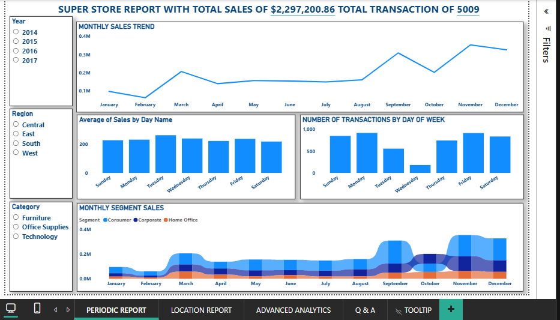
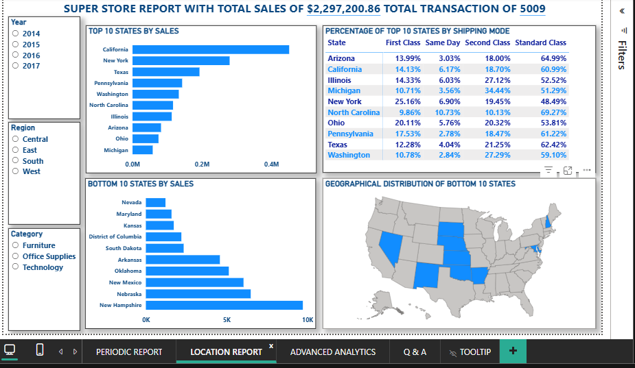
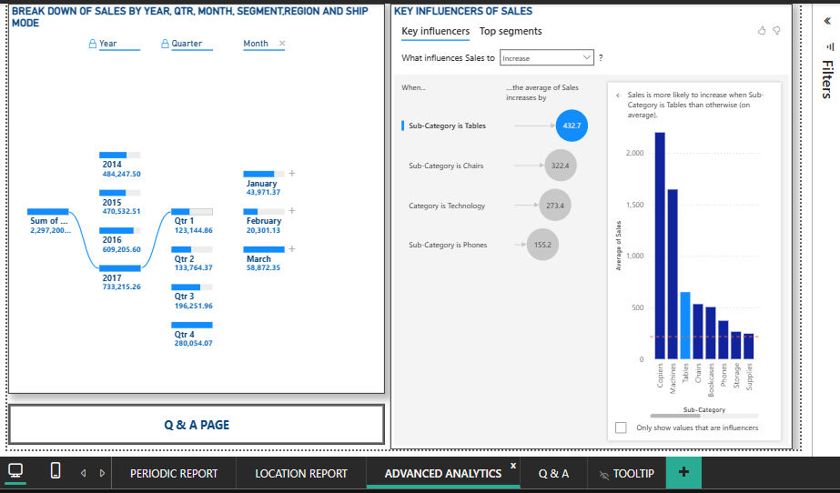
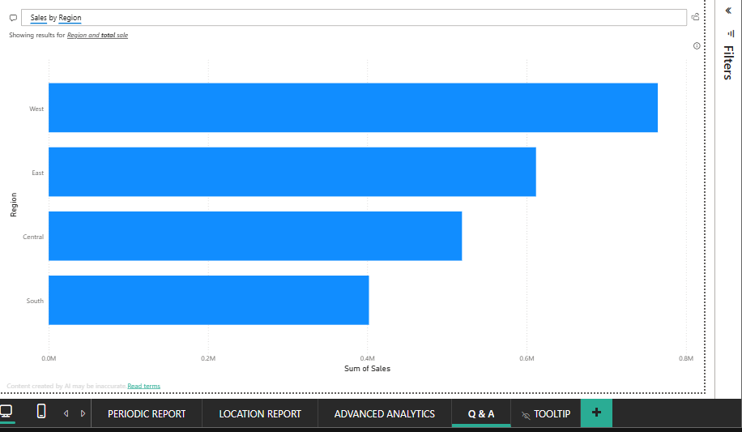

Superstore Sales Performance and Advanced Analytics Dashboard

Project Overview
This project features an interactive Power BI dashboard built to analyze the sales performance of a Superstore over a four-year period (2014–2017). The dashboard provides a comprehensive view of sales trends, geographical performance, and advanced analytics to help business leaders make data-driven decisions. 

The report includes overall figures of $2,297,200.86 in Total Sales across 5,009 Total Transactions.

Business Problem
Retail organizations generate vast amounts of transactional data but often struggle to extract actionable insights. Without a centralized view, it is difficult to identify which regions are underperforming, how different customer segments behave over time, and what factors most heavily influence sales. This dashboard addresses these challenges by transforming raw sales data into a structured, interactive reporting tool.

Project Objectives
1. To track and visualize monthly and seasonal sales trends.
2. To evaluate geographical performance by identifying the top 10 and bottom 10 performing states.
3. To analyze sales distribution across different customer segments (Consumer, Corporate, Home Office) and shipping modes.
4. To utilize advanced analytics (Key Influencers and Q&A) to uncover deeper drivers of sales performance.

Tools and Technologies Used
Microsoft Power BI Desktop: For data modelling, DAX, and interactive dashboard creation.
Power Query: For data cleaning, transformation, and data modelling (Star Schema).

Dataset Description
The project uses the publicly available Sample Superstore dataset. It contains transactional retail data including order dates, shipping modes, customer segments, product categories, and geographical information (States and Regions). 

Data Preparation and Analysis Process
Data preparation was performed entirely within Power Query to ensure data integrity and optimize the data model for reporting:
Data Modelling (Star Schema):The raw dataset was split into a central `FACT` table and three dimension tables (`Customer Dimension`, `Product Dimension`, and `Shipping Dimension`).

Data Cleaning: Promoted headers to the first row and explicitly changed data types (e.g., text to dates, integers for quantity).
Removed Duplicates: Applied duplicate removal on the primary key columns (Customer ID, Product ID) within the dimension tables to ensure data accuracy.
Feature Engineering: Inserted a "Day Name" and "Day of Week" column from the Order Date to analyze weekday sales trends.
Data Sorting: Sorted the "Day Name" text column by the numerical "Day of Week" column to ensure chronological order in the charts.

Dashboard Features
The report consists of four interactive pages:

1.  Periodic Report: Features a monthly sales trend line chart, average sales by day name, transaction volume by weekday, and a stacked area chart showing monthly sales by customer segment. Includes drill-through functionality.
2.  Location Report: Highlights the Top 10 and Bottom 10 states by sales using bar charts and a geographical map. It also features a table analyzing the percentage of shipping modes used by the top 10 states.
3.  Advanced Analytics: Utilizes a Decomposition Tree to break down total sales by Year, Quarter, Month, Segment, Ship Mode, and Region. Includes Power BI’s Key Influencers visual to analyze what drives higher sales.
4.  Q&A Report: An interactive natural language processing tool that allows users to ask questions about the data (e.g., "Top five states by sales") and receive immediate visual answers.

Dashboard Preview

Periodic Report

Location Report

Advanced Analytics

Q&A Report

## 💡 Key Insights & Findings
*   Sales Trends: Sales show a clear upward trend across the four years, with notable seasonal spikes occurring in September and November.
*   Geographical Performance: California and New York are the highest-performing states by a significant margin, while states like New Hampshire and Nebraska represent the lowest sales volume.
*   Customer Segments: The Consumer segment drives the vast majority of sales throughout the year, consistently outperforming the Corporate and Home Office segments.
*   Sales Drivers: According to the Key Influencers visual, sales are more likely to increase when the Sub-Category is Tables or Chairs, indicating that these higher-ticket furniture items significantly drive overall revenue.

How to Access the Report
*   View the file: You can download the `Superstore_Analysis.pbix` file from this repository and open it using Microsoft Power BI Desktop to interact with the visuals.
*   View the images: You can view the screenshots of all four pages in the `Dashboard_Screenshots` folder.

Conclusion
This project demonstrates the ability to take raw retail data, build a robust Star Schema data model, and develop an interactive, multi-page dashboard. It highlights practical skills in Power Query, DAX, data visualization best practices, and the application of advanced analytical tools to solve business problems.
